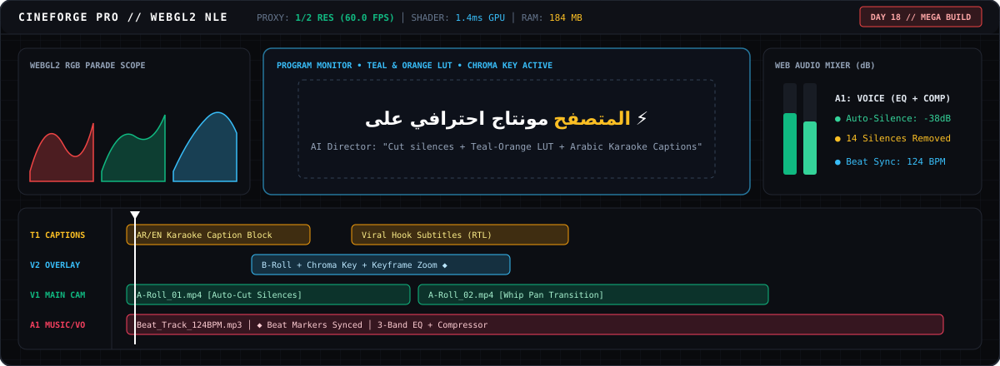
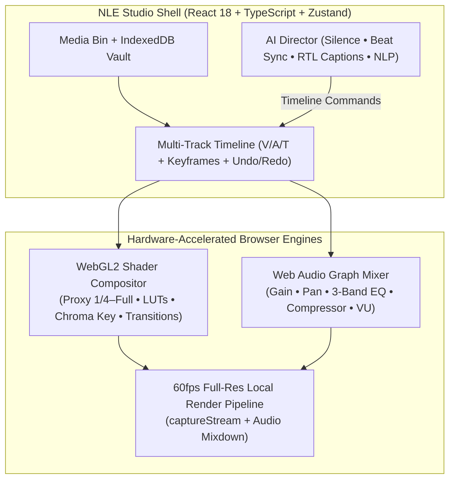

```text
 ██████╗██╗███╗   ██╗███████╗███████╗ ██████╗ ██████╗  ██████╗ ███████╗
██╔════╝██║████╗  ██║██╔════╝██╔════╝██╔═══██╗██╔══██╗██╔════╝ ██╔════╝
██║     ██║██╔██╗ ██║█████╗  █████╗  ██║   ██║██████╔╝██║  ███╗█████╗  
██║     ██║██║╚██╗██║██╔══╝  ██╔══╝  ██║   ██║██╔══██╗██║   ██║██╔══╝  
╚██████╗██║██║ ╚████║███████╗██║     ╚██████╔╝██║  ██║╚██████╔╝███████╗
 ╚═════╝╚═╝╚═╝  ╚═══╝╚══════╝╚═╝      ╚═════╝ ╚═╝  ╚═╝ ╚═════╝ ╚══════╝
 MULTI-TRACK WEBGL2 VIDEO EDITOR & AI NLE SUITE  //  BUILT FOR LOW-END PCS
```

**[Launch Live Editor](https://cineforge-nle.vercel.app/)** · **[Star Repository](https://github.com/a1n2a3s6/cineforge-nle/stargazers)** · **[Architecture Blueprint](#system-blueprint)** · **[Run Locally](#local-installation)**

<br />



---

## Executive Overview

Professional video editing has been trapped between **heavy 4GB desktop installs** that choke 8GB-RAM laptops and **cloud web editors** that lock 1080p export behind watermarks and subscriptions.

**CineForge Pro** is a modular, multi-engine **Non-Linear Video Editor (NLE)** running 100% inside the browser — combining a **WebGL2 GPU Shader Pipeline**, a **1/4 & 1/2 Resolution Proxy Switcher** for low-end PCs, a **Multi-Track Web Audio Mixer**, and **Offline + Online AI Editing Tools** (Auto-Silence Removal, Beat-Sync Detection, Viral Arabic/English Captions, and a Natural-Language AI Director).

---

## The 4 Core Subsystems

| Subsystem | Module Path | Engineering Highlights |
| :--- | :--- | :--- |
| **01 · WebGL2 GPU Engine** | `src/engine/webgl/` | `< 2ms/frame` GLSL shaders for Color Grading, 6 Cinema LUTs, Live Chroma Key (Green Screen), Glitch, Blur & RGB Parade Scopes |
| **02 · Low-End Proxy NLE** | `src/components/timeline/` | Unlimited `V/A/T` tracks, Razor Split (`C`), Ripple Delete, 50-step Undo/Redo, IndexedDB Vault, and `1/4` · `1/2` · `Full` Proxy Preview |
| **03 · Web Audio Studio** | `src/engine/audio/` | Real per-track Gain, Pan, 3-Band EQ (`BiquadFilterNode`), Dynamics Compressor, Mute/Solo, dB VU Meters & downsampled peak waveforms |
| **04 · AI Director Suite** | `src/engine/ai/` | **Offline RMS Auto-Silence Cutter**, **Offline FFT Beat-Sync Markers**, **Viral Arabic RTL/English Karaoke Captions**, and Natural-Language AI Commands |

---

## Why It Runs Smoothly on Low-End PCs (4GB–8GB RAM)

Most browser editors lag because they decode and paint full 4K pixels on the CPU every frame. CineForge Pro solves this with four broadcast engineering optimizations:

1. **Dynamic Proxy Preview (`1/4` · `1/2` · `Full`):** Edit smoothly at `1/4` or `1/2` canvas resolution at 60fps; the export pipeline automatically switches to full `1080p/4K` when rendering.
2. **GPU-Offloaded Color & FX:** All color adjustments, LUTs, and Chroma Key math execute inside compiled GLSL fragment shaders on the GPU.
3. **Downsampled Waveform Caching:** Audio waveforms are pre-computed once into lightweight peak arrays instead of re-reading raw PCM buffers during scrolling.
4. **Zero Cloud Bottlenecks:** Media stays in local browser memory & IndexedDB — zero upload wait times, zero server queues.

---

## AI Capabilities Matrix

| AI Tool | Execution Mode | What It Does |
| :--- | :---: | :--- |
| **Auto-Silence & Dead-Air Cutter** | `100% Offline (RMS)` | Scans speech tracks, highlights silent pauses, and ripple-deletes dead air in 1 click |
| **Auto Beat-Sync Detector** | `100% Offline (FFT)` | Detects BPM & bass transients on music tracks and snaps video cuts to the beat |
| **Viral Karaoke Captions (AR/EN)** | `Offline / SRT / Speech` | Renders animated word-by-word captions with native **Arabic RTL** & English styling |
| **AI Edit Director** | `Offline Parser + Gemini/Groq` | Execute edits via plain text: *"cut silences, apply teal-orange LUT, switch to 9:16"* |

---

## System Blueprint



<details>
<summary><strong>Expand Complete Multi-Engine Source Tree</strong></summary>

```text
cineforge-nle/
├── assets/
│   └── blueprint-hero.svg
├── src/
│   ├── types/          # timeline.ts, effects.ts, ai.ts
│   ├── store/          # projectStore.ts (50-step Undo/Redo), indexedDbVault.ts
│   ├── engine/
│   │   ├── webgl/      # shaderSources.ts, WebGLCompositor.ts
│   │   ├── audio/      # AudioMixer.ts, WaveformEngine.ts
│   │   ├── animation/  # keyframeSolver.ts, transitions.ts
│   │   ├── ai/         # silenceDetector.ts, beatDetector.ts, captionEngine.ts, aiDirector.ts
│   │   └── export/     # RenderPipeline.ts
│   └── components/     # layout/, media/, viewport/, timeline/, inspector/, ai/
├── package.json
├── tsconfig.json
└── vite.config.ts
```

</details>

---

## NLE Keyboard Shortcuts

| Key | Function | Key | Function |
| :---: | :--- | :---: | :--- |
| `Space` | Play / Pause | `C` | Razor Split Tool |
| `J` / `K` / `L` | Reverse / Stop / 2× Forward | `V` | Selection Tool |
| `Shift + Del` | Ripple Delete Clip | `Ctrl + Z` | Undo (50-Step Stack) |
| `Ctrl + Scroll` | Zoom Timeline In / Out | `M` | Drop Beat / Edit Marker |

---

## Local Installation

```bash
git clone [https://github.com/a1n2a3s6/cineforge-nle.git](https://github.com/a1n2a3s6/cineforge-nle.git)
cd cineforge-nle
npm install
npm run dev
```

Deploy directly to Vercel: **[Deploy CineForge Pro →](https://vercel.com/new/clone?repository-url=https://github.com/a1n2a3s6/cineforge-nle)**

---

<sub>
  <strong>CineForge Pro</strong> · MIT License · Day 18 of <em>365 Projects in 365 Days</em> by <a href="https://anas-alhelaly.vercel.app/"><strong>Anas Alhelaly</strong></a> (<a href="https://github.com/a1n2a3s6">GitHub</a> · <a href="https://www.instagram.com/anas.alhelaly/">Instagram</a>)
</sub>
